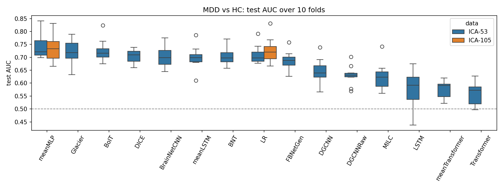
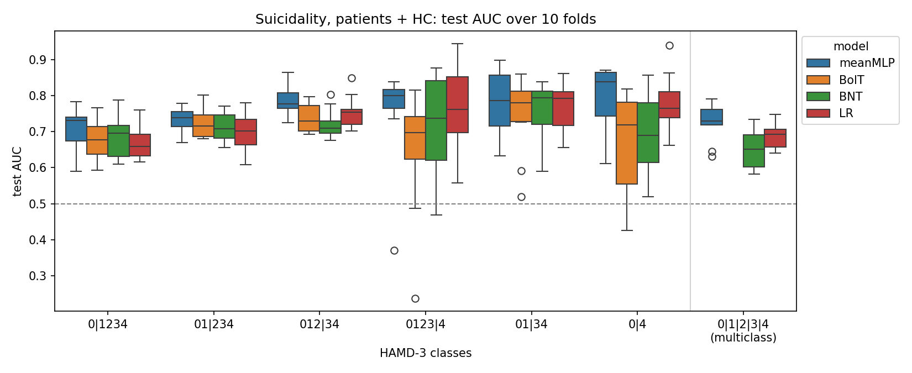
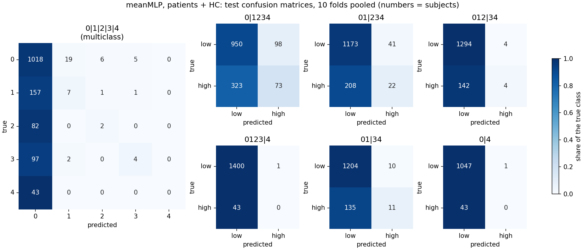
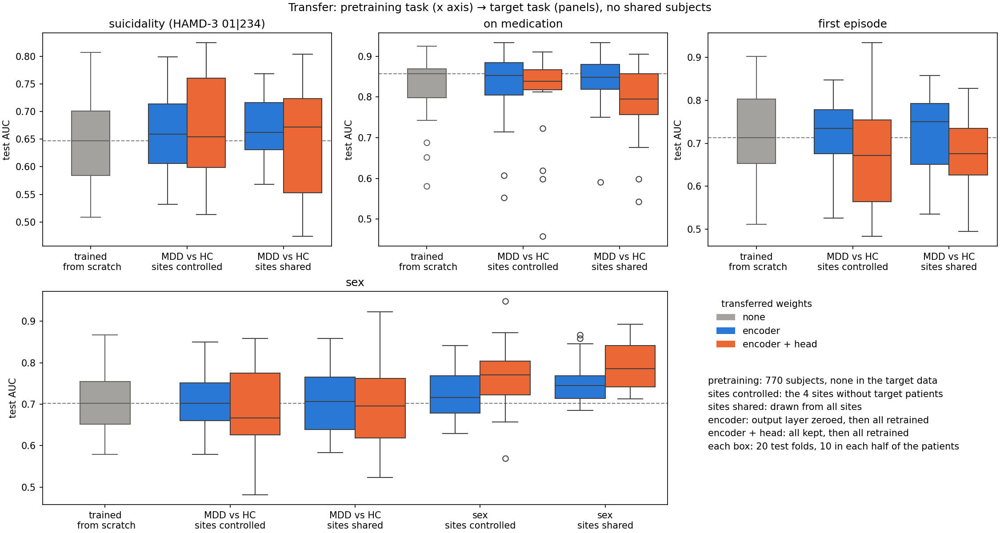

# DIRECT-II rs-fMRI: what ML can and can't predict in MDD

**Purpose.** We test whether classifying MDD vs healthy controls (HC) can serve as a pretraining objective for other clinical predictions related to MDD: suicidality, medication status, and first vs repeated episode.

**Motivation.** These within-patient targets have fewer labelled subjects and weak signal, so improving accuracy on them is a hard problem. Using a related task for pretraining is a valid way to both (a) improve scores and (b) reveal hidden connections between the tasks: successful transfer would mean the tasks share brain features, and its absence would mean that the features separating patients from controls are not the ones separating patients from each other.

**What we do.**
- Benchmark ml4fmri models and DGCNN on MDD vs HC classification
- Test suicidality performance (HAMD item 3 prediction) to find the best target.
- Pretrain meanMLP on MDD vs HC and transfer it to three clinical targets (retraining from the encoder or from the full model), with sex as a positive control and with or without site overlap between the two tasks

**Data.**
- DIRECT-II resting-state fMRI after strict quality control: 1,944 subjects (1,113 MDD / 831 HC) from 14 sites
- Inputs: NeuroMark ICA time courses (Du et al. 2020), 53 components; 105 as a check
- Evaluation: stratified 10-fold CV, with 20% of each training fold held out for early stopping; within a task, every model is scored on the same folds by test AUC

**Results summary**

| Question | Answer |
|---|---|
| Can rs-fMRI separate MDD from HC? | Modestly: best AUC 0.74 (meanMLP), most models 0.69–0.74, site alone 0.60 |
| Can it rank suicidality among patients? | Only for severe contrasts: AUC 0.56 (any vs no ideation) to 0.78 (0 vs 4) |
| Does MDD vs HC pretraining help within-patient targets? | No: ΔAUC −0.05 to +0.02 on all four targets, while the same setup transfers sex (+0.05 to +0.08) |

## 1. MDD vs HC

We first benchmark 13 ml4fmri models (time-series, connectivity and linear) and DGCNN, a graph model reported at AUC 0.79 on REST-meta-MDD (Zhu et al. 2023), on MDD vs HC classification.

*Figure 1. MDD vs HC: test AUC over 10 folds. ICA-53: all models; ICA-105: meanMLP and LR.*

- best AUC 0.741 ± 0.046, and most models fall within 0.69–0.74, logistic regression included (0.709)
- DGCNN reaches 0.645 ± 0.048, well below the 0.79 reported in the paper
- 105 components change little (meanMLP 0.735, LR 0.724)
- A classifier given only the site reaches 0.60 on the same folds

MDD vs HC is learnable from rs-fMRI but plateaus near AUC 0.74 whatever the architecture; our best balanced accuracy (68%) lies within the 61–82% reported on REST-meta-MDD (Gallo et al. 2023; Qin et al. 2022).

## 2. Suicidality (HAMD item 3)

We next classify suicidality directly: the HAMD-3 score (0–4) split into low vs high at six cut-offs, plus all five scores as classes, in patients only (n = 613) and with HC added as score 0 (n = 1,444).

*Figure 2. Suicidality, patients + HC: test AUC over 10 folds per contrast (e.g. 01|234 = scores 0–1 vs 2–4; 0|1|2|3|4 = five classes, mean one-vs-rest AUC).*

*Figure 3. meanMLP confusion matrices, patients + HC, test folds pooled.*

- In patients, meanMLP is near chance for any vs no ideation (0 v 1–4: AUC 0.56) and better for the severe contrasts (0.69 for 0–1 v 2–4, up to 0.78 for 0 v 4); five classes reach 0.65
- Adding HC lifts every contrast (0 v 1–4: 0.71), partly because HC are easy to tell from patients
- At the default threshold meanMLP predicts the low class for almost everyone: at most 18% of high-scoring patients are flagged, and none of the 43 scoring 4

Suicidality carries a weak ranking signal for the severe contrasts, but with this class imbalance the models are not usable classifiers.

## 3. Transfer from MDD vs HC

Finally we test whether MDD vs HC pretraining helps the clinical targets (Figure 4). meanMLP is pretrained on 770 subjects (MDD vs HC, or sex as a positive control) from either the 4 sites without target patients (sites controlled) or all sites (sites shared), then fully retrained on each target in the 612 patients with HAMD-3, with no subject in both, and compared with training from scratch on the same folds.

*Figure 4. Transfer: target-task test AUC over 20 folds (10 in each half of the patients). Top: MDD vs HC pretraining on the clinical targets; bottom: sex, with sex pretraining as the positive control. Dashed line: median of training from scratch.*

- Pretraining works: validation AUC 0.68–0.75 for MDD vs HC and 0.89–0.90 for sex
- Trained from scratch: AUC 0.65 (suicidality), 0.82 (medication), 0.72 (first episode), 0.71 (sex)
- Retraining from MDD vs HC models improves no target (ΔAUC −0.05 to +0.02, none significant; Nadeau–Bengio corrected paired t-test)
- Sex pretraining transfers to sex: +0.05 to +0.08 with sites shared (p < 0.05)

In this setup, the features that separate MDD from HC do not carry over to differences among patients, while the sex control shows that the setup detects transfer when tasks share features. The high scratch AUCs for medication and first episode may partly reflect site.

## Next steps

- Site-only baselines for every target, medication and first episode first
- Larger pretraining sets, such as everyone outside the target half
- HAMD-17 regression (n = 934)

## References

- Du et al. 2020, NeuroImage: Clinical (NeuroMark)
- Gallo et al. 2023, Molecular Psychiatry
- Nadeau & Bengio 2003, Machine Learning
- Popov et al. 2024, NeuroImage 303 (meanMLP)
- Qin et al. 2022, eBioMedicine
- Zhu et al. 2023, Frontiers in Human Neuroscience 17:1094592
